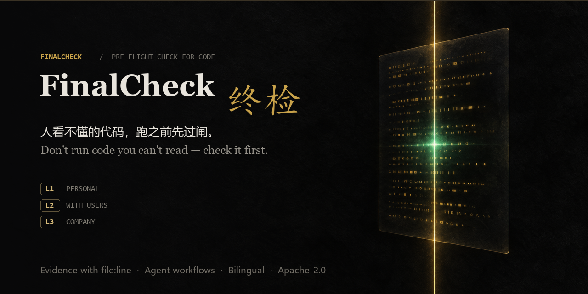

[](https://github.com/ccai40359-wq/finalcheck/actions/workflows/ci.yml)


**English** · [简体中文](README.zh-CN.md)

# FinalCheck

> **Don't run code you can't read. Check it first.**

FinalCheck is a tiered production-readiness desk for people who write with AI but are not security experts:

- **Audit before you run.** AI-written or downloaded code gets checked first, and you get a report in plain language.
- **Evidence, not vibes.** Not "possible IDOR (CWE-639)" but "`register` route defined on line 12 with no auth guard — your user table is exposed to the internet", with file and line references. Dynamic reproduction is available as an opt-in second stage.
- **Tiered gates.** Personal projects pass L1. Company projects must pass full L3 acceptance, and L3 does not ship until everything on the matrix is met.

## Tiers

| Tier | One line | Enforcement |
|---|---|---|
| **L1 Personal** | Losing the data would not hurt; only you use it | High-severity only, advisory |
| **L2 With users** | Public and receiving other people's data | High severity blocks, medium must be fixed |
| **L3 Company** | Company project, paid work, compliance obligations | Nothing ships until the matrix passes; produces a presentable acceptance report |

## What's in the box

| Piece | Form | What it does |
|---|---|---|
| **Desktop app** | Electron (Windows) | Chat + audit desk: tiered acceptance, agent workflows, live tool traces, artifact preview, usage stats |
| **Engine** | CLI (`node bin/finalcheck.js audit <dir>`) | Static gates (secrets, dependencies, risky patterns, auth matrix, semantic checks) → scorecard + issue tickets |
| **Agent runtime** | Built into the desktop app | DAG workflows **and** a restricted-script DSL, adversarial verification of every claim, journal-based resume, blind spot checks |
| **Gates & playbooks** | Skill/hook integrations + `playbooks/` | Download gate (before installing/running third-party code) and delivery gate (before handing work over) |
| **Rulebooks** | Text, per tier | What the AI must follow while writing code, so problems are prevented up front |

The npm package `finalcheck` is currently a placeholder that prints usage; the real CLI runs from this repository (`node bin/finalcheck.js audit ...`). Use the desktop app for the full experience.

## Install

### Prerequisites

- Windows 10/11 (the desktop app is Windows-first; the CLI also runs on macOS/Linux)
- Node.js 22 or newer with npm 10 or newer
- Git (needed for source installs and for the S3 git-history check)

### Installed build

1. Download the latest `fc-setup-<version>.exe` from [Releases](https://github.com/ccai40359-wq/finalcheck/releases/latest).
2. Run it and pick the install folder (a desktop shortcut is included).
3. On first launch open **Settings → Model settings** and add an OpenAI-compatible gateway (Base URL / API key / model).
4. Later versions update themselves from the same Releases page.

The build is not code-signed yet, so Windows SmartScreen may show "unrecognized app" — click **More info → Run anyway**.

### From source

```bash
git clone https://github.com/ccai40359-wq/finalcheck
cd finalcheck
npm ci
cd desktop && npm ci && npm run setup:sqlite
```

`npm ci` uses the committed lockfiles. `npm run setup:sqlite` rebuilds the `better-sqlite3` binding for the Electron ABI; run it again after changing the Electron version.

## Run

### CLI audit

```bash
node bin/finalcheck.js audit . --tier L2
```

`--tier` accepts `L1`, `L2` or `L3`. `--json` produces machine-readable output, and `--include-fixtures` pulls `**/fixtures/**` into the product verdict only when checking intentionally broken samples.

The audit is **static by default**: it does not run the audited project's test suite or quality commands, and Q1/Q2 are reported as coverage gaps instead of passes. Add `--run-tests` only for a project you trust and explicitly want executed; `--no-tests` wins over `--run-tests` when both are present. `scan-download` exits non-zero whenever it has a coverage gap, so "could not verify" never looks like a pass.

Implemented scope, limits and the manual-evidence contract are in [docs/RELIABILITY.md](docs/RELIABILITY.md).

### Desktop app

```bash
cd desktop && npm run dev
```

For a production Windows build use `cd desktop && npm run dist`; artifacts land in `desktop/release/`.

### Tests

```bash
npm test
```

To smoke-test built artifacts locally, run `npm run smoke:e2e` from the repo root after `desktop/out` exists. It opens a real window against an isolated temp profile, so it never touches your real FinalCheck data.

## Environment variables

Copy `.env.example` to `.env` if you want to override the defaults; the CLI and desktop app also run without any `.env` file. Variables used by the project:

| Variable | Required | Purpose |
|---|---|---|
| `FINALCHECK_CONFIG_FILE` | No | Override the desktop `config.json` path |
| `FINALCHECK_PROJECTS_FILE` | No | Override the workspace list file |
| `FINALCHECK_SESSIONS_DIR` | No | Override the session storage directory |
| `FINALCHECK_MEMORY_DIR` | No | Override the agent memory directory |
| `FINALCHECK_SPILL_DIR` | No | Override the oversized-tool-output spill directory |
| `FINALCHECK_USAGE_FILE` | No | Override the usage ledger file |
| `FINALCHECK_HOOKS_FILE` | No | Override the hooks configuration file |
| `FINALCHECK_SESSION_STORE` | No | Select the session store backend |
| `FINALCHECK_DEFAULT_PROJECT` | No | Default workspace when none is supplied |
| `FINALCHECK_MAX_TURNS` | No | Cap agent turns per session |
| `FINALCHECK_STREAM_USAGE` | No | Enable streaming usage accounting |
| `FINALCHECK_SQLITE_BINARY_HOST` | No | `better-sqlite3` prebuilt binary mirror |
| `ELECTRON_RENDERER_URL` | No | Dev-server URL used by `electron-vite` |
| `APPDATA` / `USERPROFILE` | Auto | Windows profile locations (set by the OS) |
| `CI` / `PYTHON` / `SMOKE_TARGET` | No | Test and smoke-test helpers |

The model API key is **not** read from an environment variable in the installed app: it is stored in the local `%APPDATA%\FinalCheck\config.json` (never committed, never written to reports) and edited through **Settings → Model settings**. `.env.example` contains names and placeholders only; never put a real key in it.

## Deploy

FinalCheck is a local desktop tool; "deploy" means building and distributing the Windows installer, not running a server.

```bash
cd desktop && npm run dist
```

This runs `electron-vite build` and then `electron-builder --win nsis --publish never`. The installer is written to `desktop/release/fc-setup-<version>.exe`; the version comes from `desktop/package.json`. Upload the artifact to the GitHub Releases page the updater reads.

CI runs the test suite and the desktop build on every change; packaging is a manual release step.

## Backup and restore

Backups are explicit and local; nothing is uploaded.

```bash
node scripts/backup.mjs --out "D:\Backups\FinalCheck"
```

The script copies the profile data (`%APPDATA%\FinalCheck`: config, sessions, memory) and the project database (`.finalcheck/finalcheck.db`) into a timestamped zip such as `finalcheck-backup-20261111-194500.zip`. Model API keys in `config.json` are replaced with `[REDACTED]` before they enter the archive; secret-looking files (`.env`, `*.pem`, `*.key`, credentials files) are skipped. The newest **7** archives are kept by default; change it with `--keep <n>` or choose another profile/project with `--profile` / `--project`.

Restore: close the app, unzip the archive, copy `config.json`, `sessions/` and `memory/` back to `%APPDATA%\FinalCheck`, and copy the database back to `<project>\.finalcheck\finalcheck.db`. Keep the previous backup until the restored app starts cleanly.

## Rollback

- **Desktop app:** reinstall the previous installer (for example `fc-setup-0.15.0.exe`) from the Releases page. User data stays in `%APPDATA%\FinalCheck`; take a backup first.
- **Source tree:** use `git revert <commit>` for a single bad change, or `git checkout <previous-tag>` to return to the previous release. Re-run `cd desktop && npm run setup:sqlite` after switching Electron versions.
- **Data:** restore the zip produced by `scripts/backup.mjs` using the steps above. Backups are the rollback path for sessions and memory because the app does not migrate data backwards.

## Troubleshooting

- **Export diagnostics:** use **Usage → Export diagnostics** (also available in **Settings → About & updates**). The exported JSON contains the app version, OS, the last 200 log lines, rule hits, and config with API keys masked. Nothing is uploaded automatically.
- **Reports look too noisy:** run a baseline first (`--write-baseline`), then use `--fail-on new` so only newly introduced blocking findings fail.
- **gitleaks/osv-scanner are missing:** S3 keeps its built-in rules and the report says so; install the tools or set their paths to enable the wider rule set.

## Language

The UI ships in Chinese and English.

- **Settings → Runtime → Language**: Follow system / 中文 / English. Switching applies immediately.
- In **English** mode the agents, workflows and generated reports also produce English output; in **Chinese** mode everything stays Chinese.
- Chinese is the default: a Chinese system with *Follow system* stays Chinese, everything else starts in English.

## Safety model

- The API key lives **only** in the local `config.json` (`%APPDATA%\FinalCheck` in the installed build). It is never written to sessions, logs or reports.
- Path and command access is controlled by a policy: `workspace` (writes inside the project only), `readonly`, or `off`. `workspace` is an application-level path policy, not an OS sandbox. Sensitive locations (`.ssh`, `.aws`, `.gnupg`, Git credentials, private keys) are blocked in every mode, and a command blacklist applies on top.
- `readonly` rejects commands, quality-gate commands and project-memory writes. Path checks resolve junctions/symlinks to their real target before deciding whether a path is inside the workspace.
- Approvals are isolated per session, project and tool; "always allow this session" never leaks across sessions or projects. The quality gate binds its approval to the normalized command config fingerprint and runs the approved config snapshot, so changing `finalcheck.quality.json` after approval requires a new approval.
- Dynamic targets (probes, stress tests) require an explicit, per-target confirmation and are capped at 60s / 50 connections.
- Removing a workspace from the list never deletes anything on disk.

## Repository layout

```
bin/          CLI entry points (finalcheck, finalcheck-mcp)
src/          audit engine (checks, probe/stress, MCP surface)
desktop/      Electron app (main / preload / renderer)
playbooks/    audit playbooks
integrations/ skill + hook wiring for coding agents
docs/         ACCEPTANCE.md — tier SSOT; RELIABILITY.md — implemented scope and evidence limits
tests/        node:test suites (1149 passing)
```

## Status

Early but real: the engine, the desktop app, tiered gates, agent workflows (DAG + script DSL), adversarial verification and in-app updates are in place, with 1149 tests passing on every change. Development follows the project's own L3 standard — a known violation of any L2 item in this repository counts as a bug.

## Author

**Sean** — [github.com/ccai40359-wq](https://github.com/ccai40359-wq) · repository: [finalcheck](https://github.com/ccai40359-wq/finalcheck)

## License

Apache-2.0. See [LICENSE](LICENSE).
