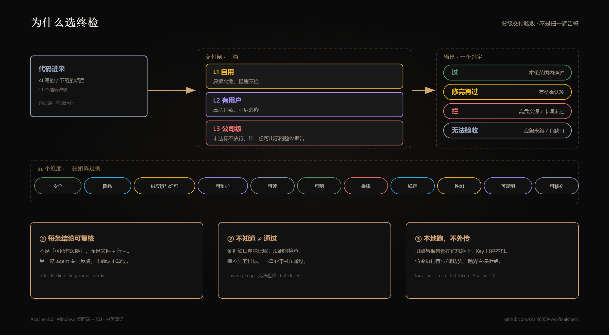

[](https://github.com/ccai40359-wq/finalcheck/actions/workflows/ci.yml)


# FinalCheck · 终检

[English](README.md) · **简体中文**

**AI 写的代码，交付前先验一遍。** 11 个维度，每条结论带文件行号，人话报告。不需要你是安全专家。

- **安全与隐私** — 裸奔的接口、注入、泄露的密钥，以及代码实际采集了哪些数据、和声明对不对得上。
- **供应链与许可证** — 装之前先过下载闸，依赖版本，许可证允不允许你商用/分发。
- **换个人接得住** — 可维护、可读、可测试。
- **真跑起来顶得住** — 鲁棒、运行稳定、性能、可观测/可运维、可移交。

`安全 · 隐私 · 供应链与许可 · 可维护 · 可读 · 可测 · 鲁棒 · 稳定 · 性能 · 可观测/可运维 · 可移交`

> 不是"可能有 IDOR（CWE-639）"，而是"**第 12 行注册了接口、没挂任何登录守卫——你的用户表对全网裸奔**"，带文件与行号；动态复现是可选第二步。

## 为什么选终检



## 分级

| 档 | 一句话 | 力度 |
|---|---|---|
| **L1 自用** | 数据丢了不心疼，只有自己用 | 只报高危，提醒不拦 |
| **L2 有用户** | 挂公网、有别人的数据进来 | 高危拦截，中危必修 |
| **L3 公司级** | 公司项目 / 收钱 / 有合规义务 | 未达标不放行，出可出示的达标报告 |

## 三件套

| 件 | 形态 | 干什么 |
|---|---|---|
| **桌面端** | Electron（Windows） | 聊天 + 体检台：分级验收、子代理工作流、实时工具轨迹、产物预览、用量统计 |
| **引擎** | 独立 CLI（`node bin/finalcheck.js audit <目录>`） | 静态关卡（密钥 / 依赖 / 坏模式 / 鉴权矩阵 / 语义检查）→ 评分卡 + 缺口工单 |
| **Agent 运行时** | 内建于桌面端 | DAG 工作流 **与** 受限脚本 DSL、每条结论强制对抗复核、journal 断点续跑、盲区检查 |
| **闸门与手册** | skill/hook 接线 + `playbooks/` | 下载闸（装/跑外部项目之前）+ 交活闸（把活交出去之前）；规则手册按档写清 AI 该守什么 |

npm 包 `finalcheck` 目前是占位包，只打印用法；真正的命令行在仓库里运行（`node bin/finalcheck.js audit ...`）。完整体验请用桌面版。

## 下载

Windows 安装包：[Releases](https://github.com/ccai40359-wq/finalcheck/releases/latest)

1. 下载最新版里的 `fc-setup-<version>.exe`
2. 双击安装，可以自己选安装目录（会建桌面快捷方式）
3. 首次打开：**设置 → 模型设置**，填一个 OpenAI 兼容网关（Base URL / API Key / 模型名）
4. 以后有新版本会在 App 里自己提示更新（读的就是同一个 Releases 页）

安装包暂未做代码签名，Windows 可能弹"未知开发者"——点 **更多信息 → 仍要运行** 即可。

## 快速开始

**安装版**

1. 从 [Releases](https://github.com/ccai40359-wq/finalcheck/releases) 下载最新的 `fc-setup-<version>.exe`。
2. 打开后进 **设置 → 模型设置**，填一个 OpenAI 兼容网关（以 `/v1` 结尾的 Base URL、API Key、模型名）。
3. 选一个工作区（文件夹），选定档位，开一个会话。

**从源码跑**

```bash
git clone https://github.com/ccai40359-wq/finalcheck
cd finalcheck
npm ci
cd desktop && npm ci && npm run setup:sqlite
cd desktop && npm run dev      # 启动桌面端
```

打包 Windows 安装包：`cd desktop && npm run dist`。

### 命令行审计

```bash
node bin/finalcheck.js audit . --tier L2
```

`--tier` 取 `L1` / `L2` / `L3`；`--json` 输出机器可读结果；`--include-fixtures` 仅在检查故意带洞的样本时把 `**/fixtures/**` 纳入产品结论。

审计**默认只做静态检查**：不执行被审项目的测试或质量命令，Q1/Q2 记为覆盖缺口，不会冒充通过。只有显式加 `--run-tests` 才执行；`--no-tests` 优先于 `--run-tests`，两者同时出现时一律禁止执行。`scan-download` 存在 `coverageGap` 时退出码非零，避免「未验证」被当成「通过」。

已实现范围、边界与人工证据契约见 [docs/RELIABILITY.md](docs/RELIABILITY.md)。

想在本地跑构建产物冒烟：在仓库根执行 `npm run smoke:e2e`（需先有 `desktop/out`）。它会开真实窗口并只用临时隔离配置，不碰你本机的真实 FinalCheck 数据。

覆盖范围说明：`npm test` 跑 node:test 套件；`npm run lint` 检查 `.mjs` 引擎/工具代码，并检查 `.jsx` 渲染层的 `t()` 遮蔽与 React Hooks 规则（渲染层不是全量 lint）；`npm run typecheck` 是逐文件 opt-in 的 3 个主进程核心模块，不是全仓。CI 还会跑 FinalCheck 自审，并校验 `.finalcheck/accept.json` 每条豁免仍与当前行内容一致。

## 排障

- **导出诊断**：**用量统计 → 导出诊断**（**设置 → 关于与更新** 里也有入口）。导出的是脱敏 JSON：版本、系统、最近 200 行日志、规则命中、配置（API Key 已打码）；不会自动上传。
- **报告太吵**：先建基线（`--write-baseline`），之后用 `--fail-on new` 只卡新引入的卡项。
- **gitleaks / osv-scanner 没装**：S3 会继续用内置规则并写明「广度有限」；装上或配好路径后规则会扩展。

## 语言

界面中英双语，**默认中文**（中文系统 + "跟随系统" 时保持中文）。

- **设置 → 运行时 → Language**：跟随系统 / 中文 / English，切换立即生效。
- 选 **English** 时，agent、工作流与生成的报告也输出英文；选 **中文** 时全部保持中文。
- 中文模式下的界面文案与原版逐字一致（`t()` 直接返回中文原文）。

## 安全模型

- API Key **只**存在本地 `config.json`（安装版在 `%APPDATA%\FinalCheck`），不写进会话、日志或报告。
- 路径与命令由策略约束：`workspace`（仅项目目录内可写）、`readonly`（全只读）、`off`（放开项目边界）。`workspace` 是应用层路径策略，不是操作系统沙箱。敏感位置（`.ssh` / `.aws` / `.gnupg` / Git 凭据 / 私钥）在所有模式下都拒绝，另有命令黑名单。
- `readonly` 禁止命令、质量命令与项目记忆写入；junction / 符号链接会先解析到真实目标，再判断是否越出工作区。
- Windows 上 `run_command` 与质量闸命令可用时会跑在 **dsh ACL 受限令牌沙箱**里：新建/改写限制在项目目录和私有 temp，沙箱初始化失败即拒绝执行（fail-closed）。它**不限制读、网络和进程可见性**，这些仍靠应用层策略；沙箱不可用时命令在宿主机执行并给出警告，设 `FINALCHECK_SANDBOX=required` 可改为直接拒绝。
- 该令牌只过滤**写**权限位，**不过滤 `DELETE`**：实测沙箱里普通 `del` 能删掉项目外的文件（`del /f` 和 PowerShell `Remove-Item` 反而被内核拒绝）。所以删除/改名命令由应用层检查目标：字面绝对路径或 `..` 路径解析到项目外即整条拒绝；含 `%VAR%`、通配符的写法不做猜测，交给命令黑名单与人工审批。
- 受限令牌写不了 Windows 命名管道和 cygwin 共享内存：`npm test` / `node --test` 会以 `EPERM` 失败，Git Bash 的 `grep`/`cat`/`head` 直接崩（Codex 的 Windows 沙箱同样 `spawn EPERM`）。这些命令改在宿主机执行并标注 `sandboxSkip`（路径策略、命令黑名单、审批照旧生效），cmd / PowerShell / git / python 仍进沙箱。沙箱子进程跑在不可见控制台，不弹黑窗；个别系统上隐藏控制台导致 `0xC0000142` 时会用可见控制台重试一次并写明原因。
- 审批按会话、项目与工具隔离，「本会话总是允许」不会跨会话或跨项目生效。**复合命令**（`a && b`、管道、`;`、换行）按整条命令审批，不会因为你允许过单条命令就把后面接的那条一起放行。质量闸的审批绑定 `finalcheck.quality.json` 归一化后的命令配置指纹，并执行审批时的配置快照；授权后改配置需要重新审批。
- 动态目标（探测 / 压测）必须逐目标显式确认，且上限 60s / 50 连接；「仅这一次」只管本次，只有选「本会话总是允许」才记住该目标。
- 从项目列表移除工作区不会删除磁盘上的任何文件。

## 仓库结构

```
bin/          CLI 入口（finalcheck、finalcheck-mcp）
src/          体检引擎（各检查项、探测/压测、MCP 接口）
desktop/      Electron 桌面端（main / preload / renderer）
playbooks/    体检 playbook
integrations/ 编码 agent 的 skill + hook 接线
docs/         ACCEPTANCE.md（分级验收的唯一事实源）、RELIABILITY.md（已实现范围与边界）
tests/        node:test 测试（当前 1196 项全绿）
```

## 状态

已能真用但仍在早期：引擎、桌面端、分级闸门、Agent 工作流（DAG + 脚本 DSL）、对抗复核与内置更新都已落地，每次改动跑 1196 项测试。本项目自身按 L3 标准开发——本仓库违反 L2 矩阵任何一条，都算 bug。

## 作者

**Sean** — [github.com/ccai40359-wq](https://github.com/ccai40359-wq) · 仓库：[finalcheck](https://github.com/ccai40359-wq/finalcheck)

## 许可证

Apache-2.0，见 [LICENSE](LICENSE)。
